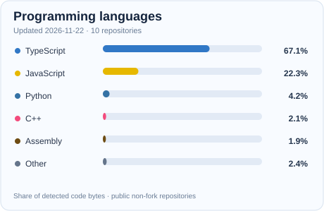
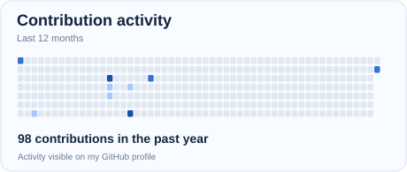

<h1 align="center">Hey, I'm John! :) 👋</h1>

  <strong>Computer Science @ University of Guelph · Software Engineering & Applied AI</strong>

  <a href="https://nguyenj1863s-projects.vercel.app/">🌐 Portfolio</a> ·
  <a href="https://nguyenj1863s-projects.vercel.app/work">Selected Work</a> ·
  <a href="https://www.linkedin.com/in/john-nguyen-a778b420b/">💼 LinkedIn</a>

<table>
  <tr>
    <td width="54%" valign="top">
      <h3>👨‍💻 A little about me</h3>
      
I'm a fourth-year Computer Science student who enjoys building things at the intersection of <strong>software, AI, and real-world problems</strong>.

      
I've worked on AI-powered document workflows at <strong>Karbon Digital</strong> and data-driven manufacturing tools at <strong>Kal-Polymers</strong>.

      
When I'm not coding, I'm probably listening to music, sketching, or exploring a new matcha spot. 🎧 🍵

      <h3>🛠️ Tech I work with</h3>
      
<strong>Languages:</strong> Python, TypeScript, JavaScript, C/C++, Java, SQL

      
<strong>Web &amp; APIs:</strong> React, Next.js, Flask, FastAPI, REST APIs

      
<strong>Data &amp; AI:</strong> PostgreSQL, PyTorch, TensorFlow.js, RAG

      
<strong>Tools:</strong> Git, Docker, Linux, pytest

    </td>
    <td width="46%" valign="top">
      
       
      
      
Language percentages reflect detected code in public repositories, not individual commits.

    </td>
  </tr>
</table>

## ✨ Featured projects

### [Aasha](https://devpost.com/software/aasha-ez5c4u) · GenAI Genesis 2026
An SMS-first maternal health triage system combining clinical RAG, patient history, and a dashboard for community health workers.

**Python · FastAPI · React · TypeScript · PostgreSQL · RAG**  
[Code](https://github.com/arjunmenon17/Aasha) · [Project details](https://devpost.com/software/aasha-ez5c4u)

### [Chromaticity](https://devpost.com/software/chromaticity-zh8tyc) · Winner for Game Creation, DandyHacks 2025
A real-time computer-vision fitness game where movement becomes the controller, with a custom hardware input option.

**Next.js · TypeScript · TensorFlow.js · Phaser · Three.js**  
[Code](https://github.com/nguyenj1863/Chromaticity) · [Project details](https://devpost.com/software/chromaticity-zh8tyc)

### [GreenShift](https://devpost.com/software/greenshift-kxpn9v) · Hack the 6ix 2025
An interactive map exploring sustainability and gentrification risks across Toronto neighbourhoods.

**Python · Flask · React · Gemini**  
[Code](https://github.com/ZainNizami/GreenShift) · [Project details](https://devpost.com/software/greenshift-kxpn9v)

### [Personal Website](https://nguyenj1863s-projects.vercel.app/)
A home for my projects, experiences, and interests, including a few music-inspired features.

**Next.js · React · Tailwind CSS · JavaScript**  
[Live site](https://nguyenj1863s-projects.vercel.app/) · [Code](https://github.com/nguyenj1863/john-website)
